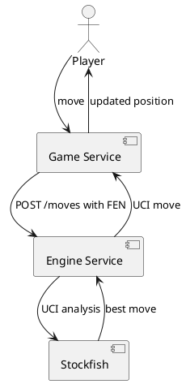

# Engine service architecture

The diagram shows only the decisions made in ADR-1 and ADR-6.

The game service sends synchronous requests over the internal Docker network. It owns game rules and game state. The engine service parses FEN and delegates move selection to Stockfish.
